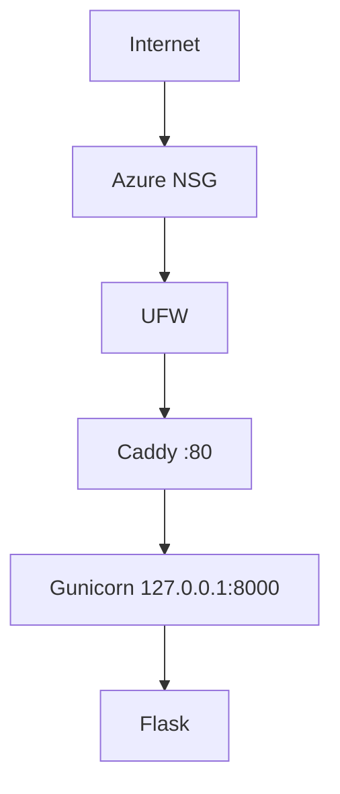

# Architecture v0.1

## Deployment View

## Resource Constraints
- 2 vCPU, sekitar 892 MiB RAM, 61 GB disk, 1 GB swap (Azure VM)
- Gunicorn: 1 worker, 2 thread agar tersisa headroom untuk SSH, systemd, Caddy

## Security Decisions
- non-root administration (user gistiegusniar)
- SSH key authentication (Ed25519)
- password SSH dan root SSH dinonaktifkan
- UFW aktif (22, 80) dan Azure NSG (22, 80)
- backend loopback-only (127.0.0.1:8000)
- GitHub deploy key khusus satu repository

## Current Limitations
- HTTP only
- single VPS
- no database
- no container
- no CI/CD

## Planned Evolution
- M04 DNS + HTTPS
- M05 persistent data
- M06 container
- M07 IaC
- M09 CI/CD
